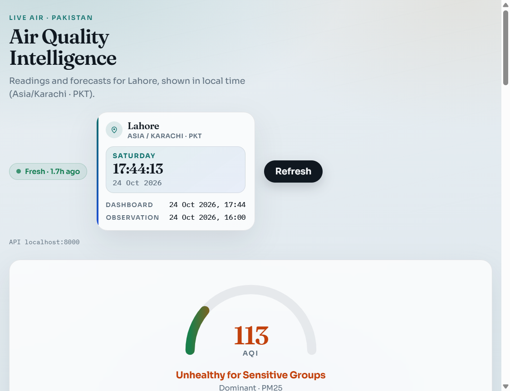
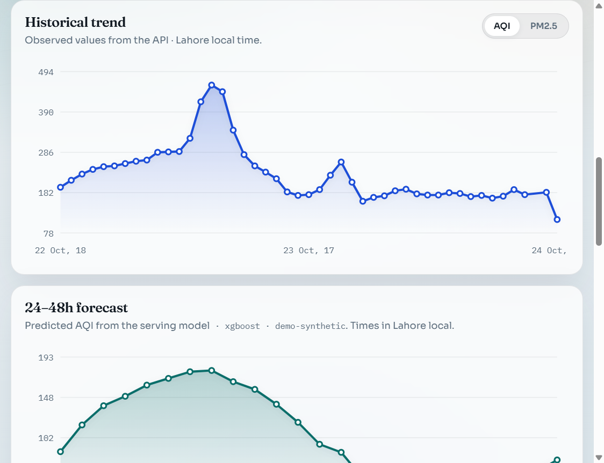

# Lahore Air Quality Intelligence Platform

Production-style data platform for **Lahore** air quality: ingest live pollution & weather feeds, warehouse and transform them, compute US EPA AQI, forecast with XGBoost, and serve results through **FastAPI** + a React dashboard.

## Live demo

| | |
|---|---|
| **Dashboard (Vercel)** | **[https://lahoreairquality.vercel.app](https://lahoreairquality.vercel.app)** |
| Local dashboard | http://localhost:8080 |
| API docs | http://localhost:8000/docs |

> The Vercel site is the React frontend. Live charts need a reachable FastAPI backend (local Docker Compose, or a public API URL set as `VITE_API_BASE_URL`).

---

## Dashboard output



**What you see on the dashboard**

| Panel | Output |
|-------|--------|
| AQI gauge | Current AQI with category color (e.g. **113 — Unhealthy for Sensitive Groups**) |
| Time & place | Lahore · Asia/Karachi · PKT clock, dashboard + observation timestamps |
| Metrics | PM2.5, temperature, humidity, wind (PM10 removed from UI) |
| Historical trend | AQI / PM2.5 toggle with SVG time series |
| Forecast | 24–48h predicted AQI from XGBoost |
| Pollutant snapshot | Horizontal bars for PM2.5, O₃, NO₂, SO₂, CO |
| Sensors & quality | OpenAQ stations + valid/suspect/invalid counts |



---

## Sample API output

**`GET /api/air-quality/current`**

```json
{
  "timestamp": "2026-10-24T11:00:00Z",
  "aqi": 113.0,
  "aqi_category": "Unhealthy for Sensitive Groups",
  "dominant_pollutant": "pm25",
  "pollutants": { "pm25": 40.5, "pm10": null, "o3": null, "no2": null, "so2": null, "co": null },
  "weather": {
    "temperature_c": 23.2,
    "relative_humidity_pct": 70.0,
    "wind_speed_ms": 1.88,
    "wind_direction_deg": 25.0
  },
  "scope": "city",
  "freshness": {
    "observed_at": "2026-10-24T11:00:00Z",
    "age_seconds": 6253,
    "is_fresh": true,
    "freshness_threshold_seconds": 7200
  }
}
```

**`GET /api/forecast?limit=3`**

```json
{
  "generated_at": "2026-10-24T12:45:09Z",
  "count": 3,
  "forecasts": [
    {
      "forecast_timestamp": "2026-10-24T13:00:00Z",
      "predicted_aqi": 86.6,
      "model_name": "xgboost",
      "model_version": "demo-synthetic",
      "forecast_horizon": 1
    },
    {
      "forecast_timestamp": "2026-10-24T14:00:00Z",
      "predicted_aqi": 116.6,
      "model_name": "xgboost",
      "model_version": "demo-synthetic"
    },
    {
      "forecast_timestamp": "2026-10-24T15:00:00Z",
      "predicted_aqi": 138.2,
      "model_name": "xgboost",
      "model_version": "demo-synthetic"
    }
  ]
}
```

Other endpoints: `/api/air-quality/history`, `/api/sensors`, `/api/data-quality`, `/health`.

---

## Architecture

```text
OpenAQ + Open-Meteo
        │
        ▼
   Poller ──► Redpanda (Kafka) ──► Consumer ──► PostgreSQL
                                      │              │
                                      ▼              ▼
                                   MinIO/S3         dbt marts
                                                       │
                         Dagster orchestration ◄───────┤
                                                       │
                              XGBoost + MLflow ◄───────┤
                                                       │
                                              FastAPI ──► React (Vercel)
```

| Layer | Technology |
|-------|------------|
| Ingestion | Python pollers → Redpanda |
| Archive | S3-compatible (S3Mock / MinIO) |
| Warehouse | PostgreSQL + Alembic |
| Transforms | dbt |
| Orchestration | Dagster |
| ML | XGBoost + MLflow |
| API | FastAPI |
| UI | React + Vite (deployed on **Vercel**) |
| Local runtime | Docker Compose |
| CI | GitHub Actions |

AQI methodology: [`docs/aqi.md`](docs/aqi.md) · Local stack: [`docs/local-stack.md`](docs/local-stack.md)

---

## Repository layout

```text
apps/            FastAPI + React dashboard
data/            Local raw/processed placeholders
dbt/             Warehouse transforms and tests
ingestion/       Poller (produce) + consumer (archive + load)
ml/              Features, training, evaluation, inference
orchestration/   Dagster assets, jobs, schedules
infrastructure/  Dockerfiles, nginx, Postgres init
tests/           Unit / integration / failure simulations
docs/            Architecture, runbooks, dashboard screenshots
scripts/         Dev utilities (e.g. seed forecasts)
```

---

## Quick start (Docker Compose)

```bash
cp .env.example .env          # set OPENAQ_API_KEY for live AQ polling
docker compose up -d --build
```

| Service | URL |
|---------|-----|
| Dashboard | http://localhost:8080 |
| API / OpenAPI | http://localhost:8000/docs |
| Dagster | http://localhost:3000 |
| MLflow | http://localhost:5000 |

```bash
docker compose down
make compose-dbt && make compose-dbt-test
make compose-train-synthetic   # XGBoost → MLflow
make smoke
```

### Dashboard only (Vercel / local Vite)

```bash
cd apps/dashboard
cp .env.example .env           # VITE_API_BASE_URL=http://localhost:8000
npm install && npm run dev     # http://localhost:5173
```

Production frontend: **[lahoreairquality.vercel.app](https://lahoreairquality.vercel.app)**  
(`apps/dashboard` → Vercel project `lahoreairquality`)

---

## Conventions

- Store and compute timestamps in **UTC**; UI shows **Asia/Karachi (PKT)**.
- Secrets via environment variables only (see `.env.example`). Never commit `.env`.
- Do not fabricate sensor readings or API responses.
- Prefer idempotent upserts (source + station + metric + observed time).

## License

MIT (see `pyproject.toml`).
